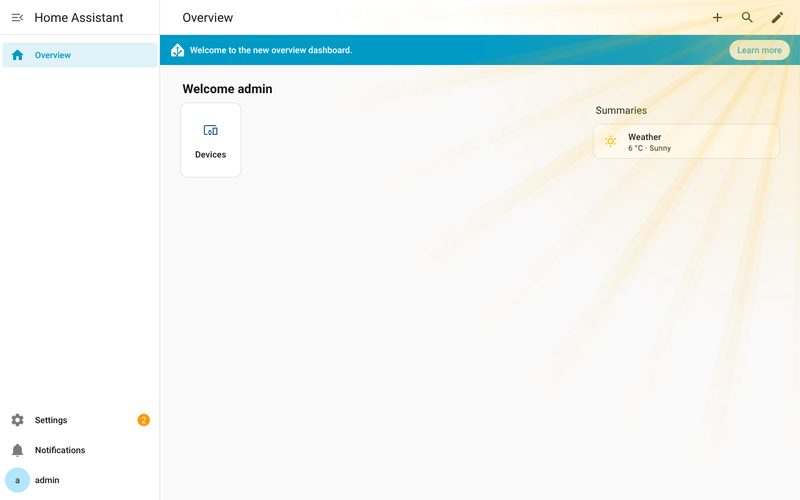
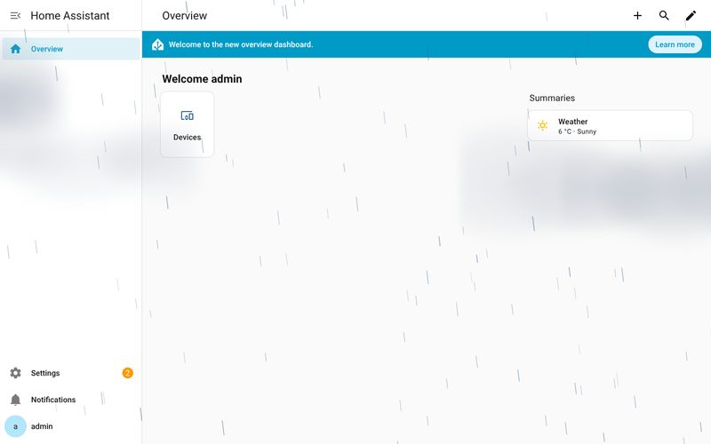
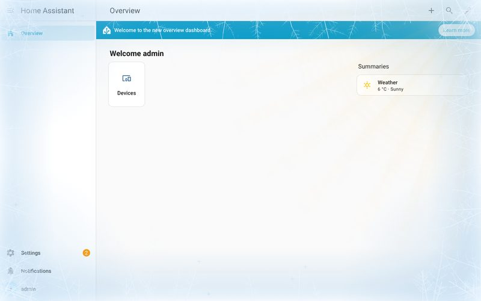
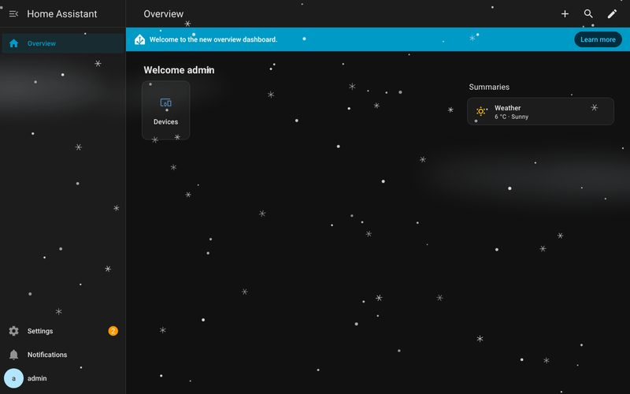
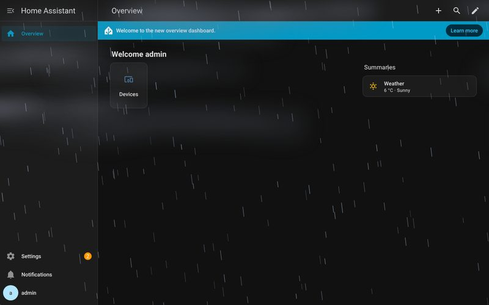
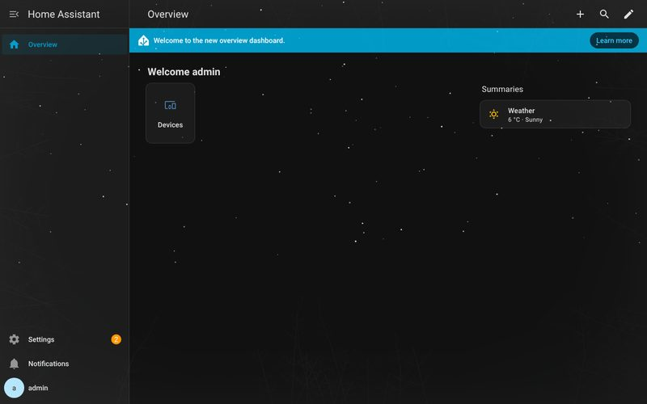
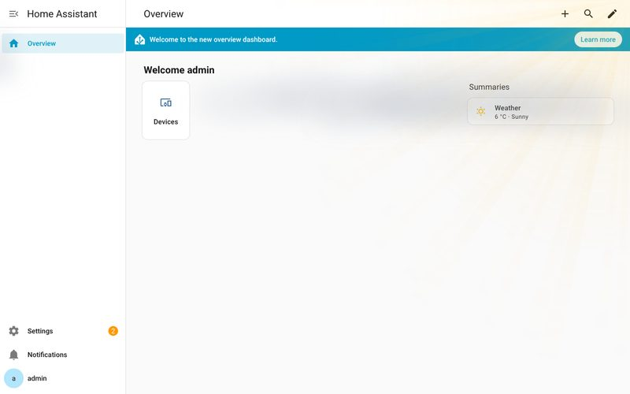
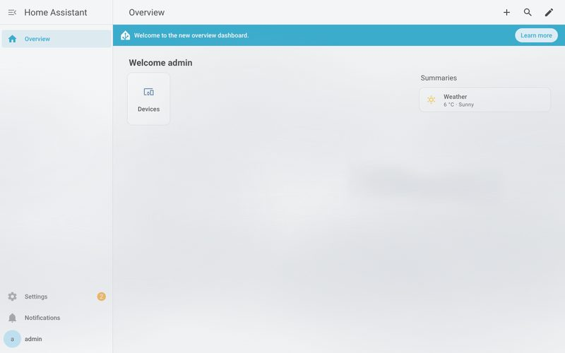
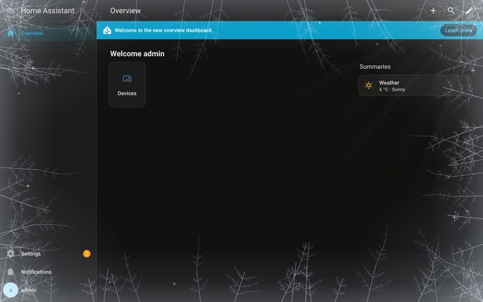

# Weather Mode for Home Assistant

Home Assistant's **Winter mode** (Settings › System › Labs) makes snow fall on your screen whatever the weather. **Weather Mode** does the same kind of thing, but shows the weather that's actually happening outside:

| Weather | What you see |
| --- | --- |
| Sunny | Soft rays of sunshine from the top corner |
| Clear night | Twinkling stars (and the odd shooting star) |
| Partly cloudy | A few thin clouds drifting across, with some sun or stars |
| Cloudy | More clouds drifting across the screen |
| Rain / heavy rain | Rain falling, slanted when it's windy |
| Thunderstorm | Rain, dark clouds, flashes and lightning bolts |
| Snow | Falling snowflakes |
| Sleet | Rain and snow together |
| Hail | Hailstones that bounce off the bottom of the screen |
| Fog | Banks of fog rolling across |
| Windy | Gusts of wind blowing across |
| Frosty (temperature at or below your setting) | Frost creeping in round the edges, with ice crystals that sparkle |

It works in light and dark mode, on every page of Home Assistant, and you can still click everything underneath.

| Sunny | Rain | Frost |
| --- | --- | --- |
|  |  |  |
| **Snow (dark mode)** | **Heavy rain (dark mode)** | **Clear night (dark mode)** |
|  |  |  |
| **Partly cloudy** | **Fog** | **Frost (dark mode)** |
|  |  |  |

## Install

### HACS / Home Assistant Marketplace

[](https://my.home-assistant.io/redirect/marketplace_repository/?owner=AdminsApples&repository=ha-weather-mode&category=integration)

Or add it by hand:

- **Home Assistant 2026.11 or newer:** Settings › Marketplace › **Add from link**, and paste `https://github.com/AdminsApples/ha-weather-mode`.
- **Older versions with HACS:** HACS › ⋮ › **Custom repositories**, paste `https://github.com/AdminsApples/ha-weather-mode` and pick **Integration**.

Then download **Weather Mode** and restart Home Assistant.

### Manually

Copy `custom_components/weather_mode` into your `config/custom_components` folder and restart Home Assistant.

## Set up

1. Settings › Devices & services › **Add integration** › **Weather Mode**.
2. Pick the weather entity to follow (Met Office, Met.no, AccuWeather or any other weather entity).
3. Go to Settings › System › **Labs** and turn on **Weather mode**.

While Weather mode is on, the built-in Winter mode snowflakes are hidden, so you won't get snow on a sunny day. (You can change that in the settings.)

## Settings

Settings › Devices & services › Weather Mode › **Configure**:

- **Weather to follow**: the weather entity.
- **How much is on screen**: Subtle, Normal or Strong.
- **Show frost when it's this cold or colder**: default 1 °C.
- **Show wind when it's windy**: adds gusts when the wind is 30 km/h or more.
- **Show on phones and narrow screens**.
- **Hide the built-in Winter mode snowflakes while Weather mode is on**.

## Trying out each effect

The integration adds a **Weather Mode Effect** select entity. Leave it on **Automatic** to follow the weather, or pick an effect (Sunny, Rain, Thunderstorm, Frost…) to see what it looks like. You can also use it in automations, for example to force snow on Christmas Day.

## Notes

- Like Winter mode, nothing shows if your device has animations turned off in its accessibility settings.
- The overlay pauses when the browser tab is hidden, so it doesn't use battery in the background.
- Needs Home Assistant 2025.12 or newer (for Labs).

## Development

```bash
pip install -r requirements_test.txt
pytest
```
